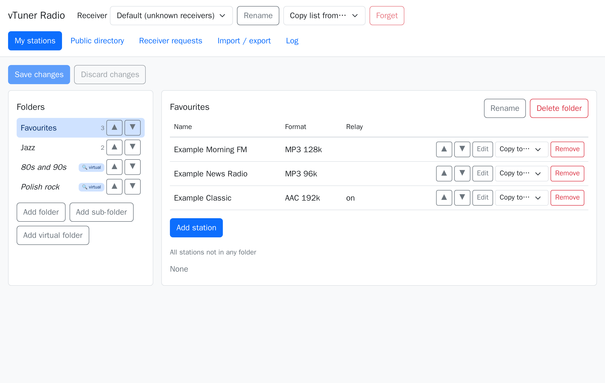
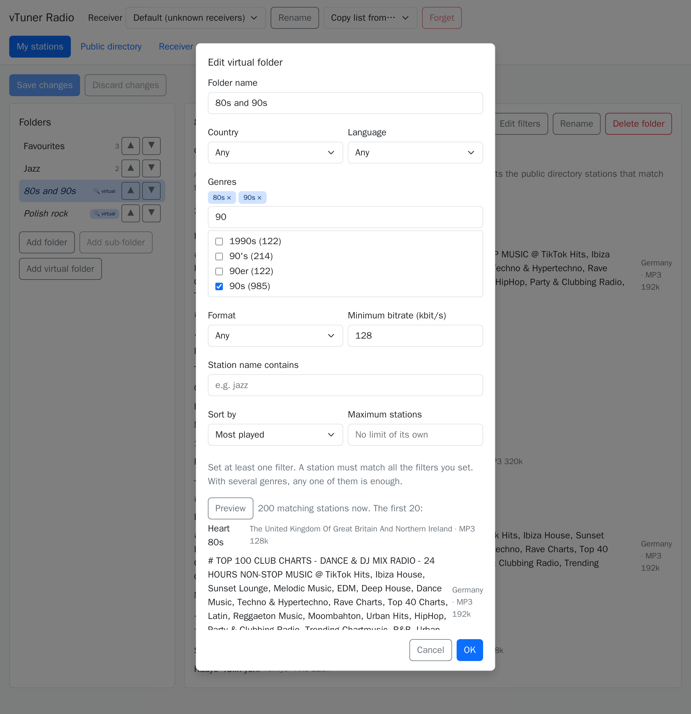
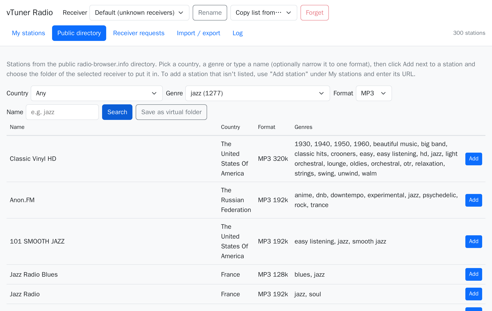
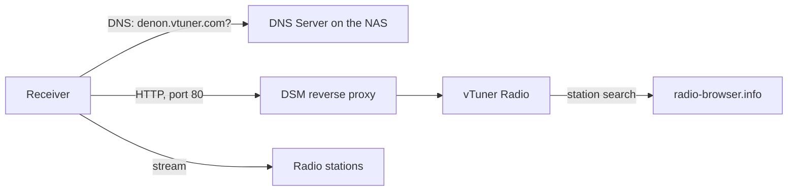

# vTuner Radio for Synology

Keep the internet radio on an older Denon receiver working, from your own Synology NAS.

Receivers like the Denon RCD-N7 get their station menus from vTuner, an online service. Many older models now only get a subscription page from it, even though the radio stations themselves are still free. vTuner Radio is a small Synology package that answers those requests instead, so the receiver's **Internet Radio** menu shows your own station lists again. Nothing changes on the receiver except its DNS server.



## What it does

**On the receiver**

- Shows your folders and stations in the normal Internet Radio menu.
- Lets you browse the public [radio-browser.info](https://www.radio-browser.info/) directory by country and genre.
- Can play HTTPS stations through the NAS (the relay), so the receiver gets a plain HTTP stream. This is automatic for directory stations and a setting for stations you add yourself.

**In the admin UI, from the DSM main menu**

- **Station lists per receiver.** Each receiver gets its own list, and you can copy lists between receivers.
- **Folders.** Sub-folders, reordering, and stations you add from the directory or by URL, with a URL test.
- **Virtual folders.** A folder that fills itself from the directory by country, up to 10 genres, language, format, minimum bitrate or name, with a sort order, a maximum size and a preview.
- **Import and export** of lists as JSON files.
- **Receiver requests and log**, to see what your receiver asks for and fix problems.

**On the NAS**

- Runs as an unprivileged package with no dependencies, and only DSM administrators can open the admin UI.
- Keeps your lists through package updates, and upgrades their format automatically after making a copy.

| Virtual folder with several genres | Public directory |
|---|---|
|  |  |

## Tested on

| | Model | Notes |
|---|---|---|
| Receiver | Denon RCD-N7 | Menus, virtual folders and playback |
| NAS | Synology DS220+ (Intel, x86_64) | DSM 7.4 |

The package needs DSM 7.0 or later, but it has only been run on the setup above. The `armv8` package is built and not tested on a real NAS. Other receivers that use vTuner may work too. If you try one, please send a [receiver test report](../../issues/new?template=receiver-report.md).

## How it works



The NAS tells the receiver that `denon.vtuner.com` is the NAS itself, and DSM's reverse proxy passes those requests to the package. Streams normally go straight from the station to the receiver, and only relayed stations pass through the NAS.

## Get started

1. Download the package for your NAS from [Releases](../../releases).
2. Point the receiver at the NAS's DNS: [How to redirect Denon vTuner to a Synology NAS](docs/redirect-denon-vtuner-to-synology.md).
3. Install the package and connect it to port 80: [How to install the package](docs/install-synology-package.md).

To try it without a NAS, you need Docker with Compose:

```sh
docker compose up --build -d
```

The admin UI is then at <http://127.0.0.1:8581/admin/>. See [How to test without a NAS](docs/testing.md).

## Documentation

| Guide | What it covers |
|---|---|
| [Redirect the receiver to the NAS](docs/redirect-denon-vtuner-to-synology.md) | DNS on the NAS and network settings on the Denon |
| [Install the package](docs/install-synology-package.md) | Installing, adding stations, updating and removing |
| [Set up the reverse proxy](docs/reverse-proxy.md) | The port 80 rule, with checks and fixes |
| [Test without a NAS](docs/testing.md) | Running the app, Docker, the test receiver and Virtual DSM |
| [Changelog](CHANGELOG.md) | What changed in each build |
| [Contributing](CONTRIBUTING.md) | Building, testing and changing stored data |
| [Getting help](SUPPORT.md) | Where to ask and what to include |
| [Security policy](SECURITY.md) | How to report a vulnerability |

## Limitations

- It's made for a home network. The receiver side has no login, because receivers can't log in, so don't forward port 80 from the internet to these host names.
- The package isn't signed, so DSM warns about an unknown publisher when you install it.
- Stations must be MP3, AAC or AAC+. HLS streams are left out, because receivers like this one can't play them.
- Directory results are only as good as radio-browser's data. Genres in particular are spelled many ways, such as `80s`, `80's` and `1980s`.

## Disclaimer

This software is provided "as is", without warranty of any kind, as the [license](LICENSE) sets out. You install and use it at your own risk. The authors accept no responsibility for any damage or loss it causes, including to your NAS, your receiver, your network or your data, so keep your own backups.

You're responsible for checking that redirecting your receiver and listening to the stations is allowed where you live, and under the terms of your device and any services involved. The authors don't control the radio stations or the public directory, and aren't responsible for their content or availability.

## License and trademarks

[MIT](LICENSE). Station data comes from the community-run [radio-browser.info](https://www.radio-browser.info/).

This is an independent project, with no connection to or endorsement from Denon, Synology or vTuner. Their names are trademarks of their owners and are used here only to say what this software works with.
